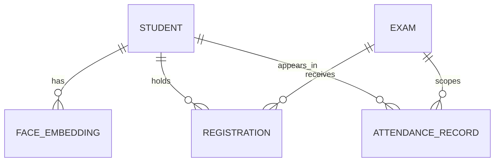

# ExamLens: AI-Assisted Examination Attendance System

## Full Technical Documentation and Academic Presentation Reference

**Prepared for:** Lecturer review and project demonstration  
**Project:** `debbiebae-com/AI-examination-attendance-system`  
**Review date:** 6 November 2026  
**Primary implementation baseline:** `main`, commit `d2f7b5823e847849ba471d700c48d78d51c7034f`  
**Latest merged feature-branch tip:** `fa4dc247a960055076baa75370cc06c8c074cb6b`  
**Documentation scope:** Architecture, implementation, algorithms, data design, deployment, branch evolution, testing, operational procedures, security, limitations and maintenance.

> **Version clarification:** This report describes the latest merged application on `main`, not only the older files in the documentation working branch. The four remote branches available at review time were inspected, together with their reachable commit history and the current session branch. The `main` and completed feature-branch tips have identical Git trees. Deleted/unavailable branches and uncommitted files on other computers cannot be audited from this repository. Claims about cloud settings or physical hardware are distinguished from source-code evidence.

---

## Contents

1. [Abstract](#1-abstract)
2. [Problem, objectives and scope](#2-problem-objectives-and-scope)
3. [Branch review and development evolution](#3-branch-review-and-development-evolution)
4. [System architecture](#4-system-architecture)
5. [Technology stack and component responsibilities](#5-technology-stack-and-component-responsibilities)
6. [Requirements and operating modes](#6-requirements-and-operating-modes)
7. [Database and persistence design](#7-database-and-persistence-design)
8. [Enrollment implementation](#8-enrollment-implementation)
9. [Recognition and tracking algorithms](#9-recognition-and-tracking-algorithms)
10. [Attendance and demonstration semantics](#10-attendance-and-demonstration-semantics)
11. [Live dashboard and local controls](#11-live-dashboard-and-local-controls)
12. [API reference](#12-api-reference)
13. [Electron application and process lifecycle](#13-electron-application-and-process-lifecycle)
14. [Deployment and configuration](#14-deployment-and-configuration)
15. [Security, privacy and ethical considerations](#15-security-privacy-and-ethical-considerations)
16. [Testing and evaluation](#16-testing-and-evaluation)
17. [Incident analysis: Windows synchronization output](#17-incident-analysis-windows-synchronization-output)
18. [Operational runbook and demonstration plan](#18-operational-runbook-and-demonstration-plan)
19. [Limitations and future work](#19-limitations-and-future-work)
20. [Conclusion and lecturer questions](#20-conclusion-and-lecturer-questions)
21. [Source references and glossary](#21-source-references-and-glossary)

---

## 1. Abstract

ExamLens is an academic prototype for identifying enrolled students from a camera feed and recording examination attendance. It combines a Python recognition backend, a mobile-friendly enrollment website, a local monitoring dashboard and an Electron desktop shell. Face detection and identity embeddings are supplied by pretrained InsightFace models. ByteTrack maintains temporary face tracks across processed frames, while separate application logic requires repeated identity agreement before attempting an attendance write.

The system supports three enrollment paths: direct web enrollment, asynchronous web submissions through a Supabase inbox, and guided local capture using a laptop webcam or a manually connected DroidCam virtual camera. In the hybrid path, the public website collects submissions but does not perform identity recognition; the organizer's computer later computes the identity embeddings. This separates lightweight public hosting from resource-intensive local inference.

A dedicated demonstration mode enables repeated single-person and multi-person presentations without manual examination registration. It isolates demonstration attendance from ordinary examination records and provides a reviewed reset operation. Normal examination mode retains registration, fee-clearance and suspension checks.

The implementation demonstrates integration of computer vision, temporal decision-making, database integrity, cloud-to-local synchronization and desktop process management. It is not a production university identity platform, a certified anti-spoofing system or evidence of a measured recognition accuracy percentage.

## 2. Problem, objectives and scope

### 2.1 Problem statement

Manual examination attendance can interrupt entry, require repetitive recordkeeping and make reconciliation difficult. A camera-assisted system can reduce manual transcription, but reliable operation requires more than recognizing a face in a single image. It must reject uncertain matches, avoid repeated attendance writes, distinguish simultaneous people, preserve records and provide a usable interface for the organizer.

Remote enrollment introduces additional issues: camera permissions, image quality, intermittent connectivity, biometric-data handling and limited cloud-compute resources. A classroom demonstration also needs predictable startup, repeatable resets and an offline enrollment fallback.

### 2.2 Objectives

- Enroll consenting volunteers and associate reference face embeddings with a student identifier.
- Detect multiple visible faces and compare them with the local enrollment gallery.
- Require identity confirmation across successive observations rather than one-frame acceptance.
- Record at most one attendance row per student and examination scope.
- Display recognized identities, activity and saved attendance clearly.
- Support remote submissions and later organizer-controlled synchronization.
- Support local guided enrollment without cloud access after dependencies/models are prepared.
- Provide a clickable Windows desktop experience using the existing working Python environment.
- Keep demonstration resets separate from deletion of students or biometric reference data.

### 2.3 Deliberate boundaries

The project does **not** implement a complete student information system, fee-payment processor, timetable engine, examination-allocation service, identity-proofing service or multi-campus administration platform. Eligibility flags are prototype data, not live university records. Fictional examination labels and agreed academic display mappings are presentation metadata, not institutional facts.

## 3. Branch review and development evolution

### 3.1 Reviewed branches

| Branch/reference | Reviewed tip | Role and observed implementation |
|---|---|---|
| `arena/e26a0f3c-ai-examination-attendance-syst` | `d4d0726` | Early backend: data model, eligibility, pretrained face recognition, evaluation utilities, guided capture and live attendance. Tracking at this stage uses box-overlap association, not ByteTrack. |
| `arena/0a58e571-ai-examination-attendance-syst` | `ebc99d9` | Adds/improves desktop capture, removes mandatory blinking, makes passive liveness optional, adds mobile web enrollment, hybrid Supabase sync, deployment configuration and cleanup tools. Still predates the dashboard/ByteTrack increment. |
| `arena/6093045b-ai-examination-attendance-syst` | `fa4dc24` | Completed demonstration iteration: ByteTrack, shared live feed, Next.js dashboard, protected local controls, phone pose verification, camera diagnostics, repeatable demo reset, local DroidCam enrollment and Electron lifecycle fixes. |
| `main` | `d2f7b58` | Merge of the completed implementation through PR #1. Its file tree is identical to the preceding feature-branch tip at review time. This is the primary reference for this report. |
| `arena/4806faaa-ai-examination-attendance-syst` | Started from `ebc99d9` | Current documentation/maintenance working branch. It starts from an older baseline; this report and the portable sync-summary correction are additions here, not evidence that this branch already contains all later application files. |

Branch tips are point-in-time references. Fetching remote branches and inspecting their contents does not require changing the active working branch. The review did not modify `main`.

### 3.2 Significant development milestones

| Commit | Technical change |
|---|---|
| `48ad9d6` | Data layer, eligibility rules, REST attendance API and simulated records. |
| `63d32f3` | InsightFace-based recognition and reference-photo enrollment. |
| `04d3a28` | Real-photo face-matching evaluation utilities. |
| `41ac927` | Initial guided capture including turn/blink checks. |
| `b5e6386`, `3c3cf60` | Blink requirement removed; passive liveness becomes opt-in. |
| `8a49194`, `74bf4f6` | Phone enrollment website and hybrid Supabase inbox synchronization. |
| `67b67a8` | ByteTrack integration, local shared live state and Next.js dashboard. |
| `f04ce5b` | Browser head-pose verification before accepting phone frames. |
| `66cafcb` | Dark charcoal/amber dashboard presentation direction. |
| `493e05d`, `da31045`, `a22fb17` | Camera selection, preservation of DroidCam's negotiated format and isolated diagnostics. |
| `8fdb765` | Simplified recognition demonstration, combined reset and guided local enrollment. |
| `f3519db` | Electron desktop wrapper with managed local services. |
| `bad9c13` | Explicit installation of the pinned Electron runtime during preparation. |
| `fa4dc24` | Startup/shutdown completion uses process exit rather than waiting for inherited output pipes. |

**Interpretation:** Older screenshots, README passages or comments may describe superseded behavior. The final design does not require a blink challenge, manual registration buttons or classroom selection for demonstration mode. It does use ByteTrack, not the initial overlap-only tracker.

## 4. System architecture

### 4.1 Logical architecture

```mermaid
flowchart LR
    Student[Student phone browser] --> Web[React enrollment site / Netlify]
    Web -->|Public insert-only submission| Inbox[(Supabase enrollment inbox)]
    Inbox -->|Organizer sync / secret server key| Sync[Python synchronization worker]
    Sync --> Embed[InsightFace embedding pipeline]
    Native[Local guided capture] --> Embed
    Camera[Laptop webcam or DroidCam virtual camera] --> Native
    Camera --> Recognizer[SCRFD + ArcFace + ByteTrack + confirmation]
    Embed --> DB[(Local application database)]
    DB --> Recognizer
    Recognizer --> DB
    Recognizer --> Live[(Local SQLite live snapshot)]
    DB --> API[FastAPI local service]
    Live --> API
    API --> Proxy[Next.js same-origin API proxy]
    Proxy --> Dashboard[Organizer dashboard]
    Dashboard --> Electron[Electron desktop window]
```



Direct web enrollment is an alternative path: browser frames can be posted to FastAPI `/enroll` without the Supabase inbox. Public hybrid enrollment is preferred when the organizer's PC need not be continuously reachable.

### 4.2 Deployment boundaries

| Boundary | Runs there | Does not run there |
|---|---|---|
| Student browser | Consent/details form, camera preview, MediaPipe pose checking, submission upload | InsightFace identity matching against the organizer's gallery |
| Netlify | Built enrollment website and static pose assets | Desktop Electron window, local camera recognition or Python background workers |
| Supabase | Temporary enrollment inbox and row-level access rules | Local camera feed processing |
| Organizer PC | Python models, embeddings, attendance DB, live snapshot, dashboard server, Electron | Dependence on a cloud GPU for the normal demonstration |

### 4.3 Architectural rationale

The hybrid design avoids requiring a resource-constrained public host to run the full face model. The organizer controls when remote submissions become usable local embeddings. Local inference also permits a demonstration without internet, provided models and packages have already been installed. Electron improves operation; it does not replace the Python vision pipeline.

## 5. Technology stack and component responsibilities

| Technology | Responsibility |
|---|---|
| Python, FastAPI, Uvicorn | Local API and orchestration endpoints. |
| SQLAlchemy | Database models, sessions and persistence queries. |
| SQLite | Default application database and a separate live-session snapshot store. |
| InsightFace / `buffalo_l` | Pretrained face detection, alignment, embeddings and enrollment pose support. |
| ONNX Runtime | Model execution using the configured CPU execution provider. |
| NumPy | Embedding storage conversion, normalization and similarity calculations. |
| OpenCV | Camera capture, image decoding and native capture/recognition windows. |
| Supervision / ByteTrack | Motion-based multi-face association across processed frames. |
| React, TypeScript, Vite | Mobile enrollment website. |
| MediaPipe Tasks Vision | Browser facial landmarks and pose estimation; not student identity recognition. |
| Next.js, React, Radix/shadcn components, Recharts | Local dashboard, controls, charts and same-origin API proxy. |
| Electron | Desktop application shell around the existing local dashboard. |
| Supabase REST API | Public submission inbox and organizer synchronization. |
| Windows PowerShell, CMD | Preparation, readiness checks, process ownership and shutdown. |
| pytest, Vitest, Node test runner | Backend, browser logic/UI and desktop lifecycle regression tests. |

Python metadata permits Python 3.11 or later; the user's working Windows environment has used Python 3.12. Node.js must meet the project's `>=22.12.0` requirement. The reviewed desktop package pins Electron `45.2.3`. Reproducible installations use committed lockfiles, rather than assuming every dependency is permanently fixed by a version range in a package manifest.

### 5.1 Repository map at the primary baseline

```text
backend/app/
  models.py, db.py             Relational persistence
  attendance.py, eligibility.py Attendance integrity and normal examination rules
  sync.py                     Supabase inbox processing
  control.py                  Protected organizer task endpoints
  demo.py, presentation.py     Isolated demo scope and display-only metadata
  live.py                     Cross-process session snapshot
  vision/
    embedder.py, gallery.py, matcher.py
    attendance_flow.py, attend.py
    capture_flow.py, capture.py, sample_worker.py
    web_enroll.py, camera.py, camera_source.py
    camera_check.py, camera_diagnostics.py
    evaluate.py, validate_video.py
frontend/                     Public student enrollment website
 dashboard/                   Local dashboard and API proxy
 desktop/                     Electron shell and lifecycle tests
 docs/                        Deployment, validation and operating guides
 start-demo.ps1               Shared Windows process manager
```

## 6. Requirements and operating modes

### 6.1 Functional requirements

| ID | Requirement | Implementation mechanism |
|---|---|---|
| FR-01 | Accept student details and consented reference frames | Browser form and guided local capture. |
| FR-02 | Extract reference embeddings | Shared InsightFace model configuration. |
| FR-03 | Identify multiple enrolled faces | Per-face detection, matching and ByteTrack association. |
| FR-04 | Reject uncertain identities | Similarity threshold, runner-up margin and repeated confirmation. |
| FR-05 | Prevent duplicate attendance | Database unique constraint on examination/student pair. |
| FR-06 | Support ordinary examination eligibility | Registration, fee and suspension checks. |
| FR-07 | Support presentation without manual registration | Explicit isolated demonstration mode. |
| FR-08 | Repeat demonstrations without re-enrollment | Combined demo attendance/live-state reset. |
| FR-09 | Import remote volunteer submissions | Pending-inbox synchronization and per-submission results. |
| FR-10 | Operate locally when internet is unavailable | Prepared models, local guided capture and local services. |
| FR-11 | Start without typing server commands | Electron shortcut and prepared Windows launcher. |
| FR-12 | Export results | Dashboard CSV export. |

### 6.2 Non-functional requirements and qualifications

- **Responsiveness:** Threaded camera capture favors recent frames over processing every buffered frame.
- **Integrity:** Repeated observations and concurrent writes must not create duplicate attendance rows.
- **Maintainability:** Decision logic is separated from cameras and models so tests can use synthetic inputs.
- **Operational safety:** Camera, enrollment, sync and destructive tasks have local mutual-exclusion guards.
- **Privacy:** Cloud photos are cleared after successful sync by default; biometric data is still sensitive locally.
- **Usability:** Startup readiness and safe shutdown are managed by the desktop application.
- **Reproducibility:** Source revision, dependency lockfiles, model choice and hardware settings must be recorded.

These are design requirements, not proof that the prototype meets a formal availability SLA or security certification.

## 7. Database and persistence design

### 7.1 Relational model



| Entity | Principal fields | Important constraints/purpose |
|---|---|---|
| `Student` | `id`, `student_no`, `full_name`, `programme`, `level`, `fees_cleared`, `suspended`, `photo_path` | Unique student number; prototype eligibility flags. |
| `Exam` | `id`, `course_code`, `course_title`, `hall`, `starts_at`, `ends_at` | Scope for registration and attendance; course code is indexed, not declared globally unique by this schema. |
| `Registration` | `id`, `student_id`, `exam_id` | Unique `(student_id, exam_id)`. |
| `AttendanceRecord` | `id`, `exam_id`, `student_id`, `recorded_at`, `confidence`, `source` | Unique `(exam_id, student_id)` prevents duplicate attendance. |
| `FaceEmbedding` | `id`, `student_id`, `embedding`, `source_photo`, `det_score` | Multiple reference vectors per student; source distinguishes reference/capture/web samples. |

An embedding contains 512 `float32` values: approximately `512 × 4 = 2,048` raw bytes before database overhead. This is a feature representation, not a human-readable photo and not an anonymization guarantee.

### 7.2 Persistence boundaries

- Default application data: `backend/data/exam_attendance.db`, unless `DATABASE_URL` overrides it.
- Live state: `backend/data/live_session.db`, independent of the main application database.
- Model cache: local InsightFace model directory associated with the Windows user.
- Local organizer secret: `backend/data/control.key`.
- Windows launcher state and logs: `.demo-runtime/`.

Live snapshots contain session metadata and events, not stored camera images or embedding arrays. Attendance timestamps are stored as UTC-oriented datetimes. UTC and Ghana's current time offset coincide, but timestamp handling should remain explicit when exporting or hosting elsewhere.

### 7.3 Cloud inbox model

`enroll_submissions` contains a generated UUID, student number, name, optional examination code, photo JSON, status, error text and creation/synchronization timestamps. Photo entries have a pose label and a base64-encoded image. This is a submission queue, not the authoritative attendance database.

Statuses used by the application are `pending`, `synced` and `failed`. The supplied SQL documents this convention; the shown schema does not declare a database enum enforcing those exact values. A status/creation-time index supports pending-row retrieval.

## 8. Enrollment implementation

### 8.1 Phone/browser enrollment

1. The volunteer enters a name and student identifier and supplies consent through the interface.
2. The browser requests camera permission in a secure context.
3. MediaPipe checks that exactly one face is suitably positioned.
4. The volunteer looks straight, turns left and turns right.
5. Accepted snapshots are collected for each pose.
6. The submission goes either to the Supabase inbox or directly to FastAPI.

The intended browser collection is three frames per pose, nine total. The pose gate uses a 600 ms hold requirement with multiple valid observations. The checked snapshot is retained for capture rather than sampling a later frame after asynchronous processing finishes.

Selected browser checks include:

| Check | Reviewed value |
|---|---|
| Straight yaw | Absolute yaw no greater than 10° |
| Requested turn | Approximately 18–45° in the requested direction |
| Pitch | Absolute pitch no greater than 20° |
| Roll | Absolute roll no greater than 18° |
| Hold | At least 600 ms with sufficient valid observations |
| Stale sample gap | Gate resets after an excessive gap; default 1,000 ms |

Pose estimation runs in a worker using image snapshots and OffscreenCanvas where supported. Unsupported browsers, failed model initialization and invalid observations fail closed rather than silently pretending verification succeeded. Pose/WASM assets are prepared for the website build; the pose-model file is checksum-checked by the build script.

**Security qualification:** Browser pose checks improve enrollment guidance. They are not trusted server-side identity proof. A malicious client can construct requests, and head movement is not a certified defense against replay or synthetic video.

### 8.2 Hybrid inbox synchronization

```mermaid
sequenceDiagram
    participant Phone
    participant Inbox as Supabase inbox
    participant Sync as Organizer sync
    participant Model as InsightFace
    participant DB as Local database
    Phone->>Inbox: Insert details + guided frames
    Sync->>Inbox: Fetch pending rows
    loop Each submission
        Sync->>Model: Decode/analyse submitted frames
        Model-->>Sync: Usable embeddings or problems
        Sync->>DB: Create/update student and web samples
        Sync->>Inbox: Mark synced; clear photos by default
    end
    Sync-->>Sync: Print summary
```

The backend service-role key stays on the organizer's computer. A successful sync creates or updates the local student, replaces that student's prior `web:` samples and records the cloud row as synchronized. Optional exam registration may occur if an appropriate existing exam is supplied. Demonstration recognition does not depend on that registration.

A failed submission is marked failed with an explanation. It is not normally selected again by a pending-only fetch. Resubmission or deliberate operator intervention is needed after correction.

**Consistency limitation:** Local database commits and Supabase updates are separate operations, not one distributed transaction. A connection failure after local persistence but before the cloud acknowledgment can leave a pending cloud row although local samples exist. Reprocessing is designed to replace the prior web sample set rather than accumulate duplicates, but the system should not be described as an exactly-once distributed queue.

### 8.3 Backend acceptance versus browser guidance

The browser aims to collect all three poses. However, `web_enroll.py` uses `MIN_SAMPLES = 1` for saving usable embeddings. It can retain a partially usable batch and return warnings. Therefore, “the browser requests nine guided frames” is accurate; “the backend cryptographically proves all nine frames and all three poses” is not.

The current usable-face filter operates on detections with embeddings; stronger checks against all detected faces and stricter server-side quality rules remain useful hardening work.

### 8.4 Local enrollment

The organizer enters a volunteer ID and full name, chooses the existing PC/DroidCam camera settings and starts local enrollment. `capture.py` opens its native guidance window and processes straight/left/right poses. Defaults include three samples per pose, a minimum spacing of six processed frames between samples and smoothed yaw guidance.

Cheap guidance runs for incoming frames; expensive embedding work runs on a worker for accepted samples. Captures are reconciled with worker results before saving. The final local capture path creates/updates the student only after a successful capture and stores `capture:` samples. Cancelled or failed capture does not replace saved samples or create an empty new student in the final implementation.

Re-enrolling an existing ID requires an explicit confirmation flag. Successful replacement affects that person's local capture samples, not their phone samples, prior attendance, eligibility flags or existing stored name. Local enrollment needs no Supabase connection once the full model pack and dependencies are cached.

## 9. Recognition and tracking algorithms

### 9.1 Pretrained pipeline

The project integrates pretrained models; it does not train a new neural network from scratch.

1. Read the latest camera frame.
2. Detect faces with the detector in the selected InsightFace pack, normally `buffalo_l`.
3. Align each detected face using landmark information.
4. Compute an ArcFace-style identity embedding.
5. Compare the embedding against enrolled reference vectors.
6. Associate detected boxes across frames with ByteTrack.
7. Confirm consistent identity observations.
8. Attempt the appropriate attendance write and publish activity.

Recognition-only configuration loads detection/recognition modules rather than all enrollment-related pose/attribute models. Enrollment and recognition must use compatible model packs; changing to an unrelated embedding model without re-enrollment makes vector comparison invalid.

### 9.2 Embedding normalization and matching

For an embedding vector \(x\), the matcher normalizes it:

\[
\hat{x}=\frac{x}{\|x\|_2}
\]

For a normalized query \(q\) and reference \(r\), cosine similarity is:

\[
s(q,r)=\hat{q}^{T}\hat{r}
\]

Each student may have multiple references. The student score is the highest similarity over that student's references:

\[
S_i=\max_j s(q,r_{ij})
\]

Let \(S_1\) be the highest student score and \(S_2\) the highest score for a **different** student. A candidate is accepted by the matcher only if:

\[
S_1\geq0.40\quad\land\quad S_1-S_2\geq0.05
\]

The defaults are starting configuration values, not empirically certified operating thresholds. The runner-up must be a different identity; two pictures of the same student should not create an artificial ambiguity penalty. A zero-norm embedding is rejected. Similarity is **not** an accuracy percentage or a calibrated probability.

### 9.3 ByteTrack and identity confirmation

The final `FaceTracker` adapts Supervision's ByteTrack implementation, using detector boxes and detector confidence. Motion association and student identity evidence are deliberately separate. A track ID means “a temporarily tracked face,” not “a permanently authenticated person.”

Reviewed defaults include a detector score floor of `0.1`, high-confidence tracking activation at `0.5`, a lost-track buffer of ten processed updates and three consistent identity observations for confirmation. Unconfirmed tracker detections can return no ID; the adapter does not invent an ID for a rejected detection.

Recognition evidence is reset when observation gaps interrupt consecutive evidence or when the identity candidate changes. The same person may acquire a new track after leaving and returning. The database constraint, rather than permanent tracker memory, prevents repeated attendance rows.

### 9.4 Camera and processing performance

A background `CameraReader` continually retrieves frames. The recognition loop consumes the newest available frame and skips unchanged sequence numbers. This reduces stale-frame lag when inference is slower than camera capture. It intentionally does not guarantee processing of every physical camera frame.

Managed dashboard recognition uses detector size 480 and four ONNX Runtime threads. The standalone CLI's detector-size default remains 640; these values must not be confused in performance reports. Lower resolution may improve speed but can reduce distant/small-face detection quality.

DroidCam is accessed as a local OpenCV camera device. Source labels do not discover hardware identity. Device indices may change across backends or reconnection. Phone mode preserves the driver's negotiated frame format instead of forcing resolution/FPS changes that previously caused corruption. The user connects the phone/client manually.

### 9.5 Liveness boundaries

Passive liveness is optional and off by default. Guided turns provide a presentation interaction and additional pose diversity, but neither turns nor the optional model justify claiming robust presentation-attack detection. A photograph, replay, deepfake or malicious enrollment client remains part of a security evaluation that this prototype has not completed. Older comments describing a turn as proof of liveness should not be presented as experimental evidence.

## 10. Attendance and demonstration semantics

### 10.1 Normal examination mode

Normal attendance requires a known student and exam, registration for that exam, cleared fees and no suspension/academic hold according to stored prototype flags. A pre-existing attendance record is returned rather than duplicated. A uniqueness constraint also handles races between concurrent attempts.

The ordinary API is not a substitute for an institutional eligibility source. These checks demonstrate rule integration; they do not independently prove the truth of the stored flags.

### 10.2 Explicit demonstration mode

The final organizer flow has no classroom selector or manual registration requirement. It uses an automatically managed internal exam code, `EXAMLENS-DEMO`, to isolate repeatable demonstration records within the existing attendance schema.

In this mode:

- A matched student must have enrolled face samples.
- Ordinary exam registration/fee/suspension gating is bypassed explicitly for the isolated demo scope.
- Stored eligibility flags are not changed.
- Attendance source is recorded as `demo`.
- The demo bypass is not permitted for an arbitrary real examination.
- Ordinary exam mode keeps its original rules.

This is recognition demonstration, not an authorization decision about entering a real examination.

### 10.3 Combined reset

The desktop dashboard requests a safe stop for dashboard-started recognition before previewing a reset. A short-lived, single-use token represents the preview. The operator sees affected attendance/event/identified counts and explicitly confirms.

Confirmation checks that the relevant records and live snapshot have not changed, clears attendance only within the internal demo scope and resets live activity/counters with a fresh session identity. Students, face samples, registrations and other exams' attendance remain.

The next recognition start creates a new tracker/decider/publisher and reloads the gallery. The same volunteer can be recorded again because the prior demo attendance row has been removed. Clearing only a screen would not achieve this; deleting face data is neither necessary nor appropriate.

**Boundary:** Application attendance and live state use separate SQLite stores. Preview guards and local write locks reduce races, but they are not a distributed all-or-nothing transaction across every persistence boundary. Production recovery should reconcile partial failures explicitly.

### 10.4 Presentation metadata

The UI maps agreed index patterns to display details, including `CSC` to “Computer Science and Information Technology” and year code `24` to Level 300. This is an explicit presentation rule, not a general formula for calculating academic standing.

Fictional sample examination labels are assigned deterministically by hashing a normalized student identifier into a pool of six sample courses. They remain stable across frames/restarts and can repeat across students. The overlay labels them **Demo exam**. They do not create registrations or change saved attendance scope. Unknown/checking faces are not given confirmed-identity academic details.

## 11. Live dashboard and local controls

### 11.1 Dashboard behavior

The Next.js dashboard shows session status, recognized identities, activity, saved attendance, student details, academic display metadata and charts. It supports search and CSV export. Layout illustration is explicit rather than silently inserting fictional students into the real live view.

Saved presence counts and current-session identification counts are different:

- **Saved presence:** persisted attendance in the selected/internal scope, potentially spanning multiple runs until cleared.
- **Identified count:** distinct identities observed in the current live session.
- **Visible faces/unidentified now:** transient observations, not persistent attendance.

### 11.2 Live store

A separate SQLite snapshot allows the camera subprocess and FastAPI process to exchange session state without sharing Python memory. A session UUID identifies the publisher. Fresh active ownership prevents a second publisher taking over. Heartbeat age can mark a session disconnected after the reviewed 120-second stale threshold.

Events are bounded to the latest 100 entries. Event IDs and a session ID allow clients to reset cursors and detect truncation. The dashboard uses polling, not an implemented WebSocket stream. This snapshot is not a permanent institutional audit log.

### 11.3 Local controls

Protected controls include camera start/check/stop, task status, synchronization, guided local enrollment, readiness information and preview/confirm operations. A process manager serializes conflicting work. Native camera checks run in bounded child processes because drivers can block. A received frame is not proof of the intended device, correct colors or recognition accuracy.

Advanced student deletion is separate from resetting attendance. It previews affected students and dependent records and requires typed confirmation. Local deletion does not automatically delete Supabase submissions; syncing pending submissions can recreate local identities unless cloud cleanup is handled deliberately.

### 11.4 Same-origin proxy

Browser controls call Next.js `/api/...` routes. The server-side proxy restricts allowed paths and attaches the local control key when calling FastAPI. The key is read on the server, not embedded in the public client bundle. Control POST requests check their Origin against the request host/forwarded host.

This protects the local control surface in the intended deployment. It is not a complete authenticated university portal, and proxy/origin assumptions require care if exposed publicly.

## 12. API reference

The following is a concise implementation reference, not a claim that every endpoint has production authentication or exhaustive input limits. FastAPI `/docs` provides generated schemas for the version actually running.

### 12.1 Core API

| Method | Path | Purpose |
|---|---|---|
| GET | `/health` | Lightweight readiness response. |
| GET | `/students` | Local students and face-sample/display information. |
| GET | `/exams` | Examination metadata. |
| POST | `/enroll` | Decode supplied frames and save web enrollment embeddings. |
| GET | `/exams/{exam_id}/attendance` | Saved attendance for an exam scope. |
| POST | `/exams/{exam_id}/attendance` | Ordinary attendance write with normal eligibility checks. |
| GET | `/live/session` | Current live snapshot and persisted count; supports event cursor input. |

An example web enrollment shape, with placeholders rather than real biometric content:

```json
{
  "full_name": "Demo Volunteer",
  "student_no": "DEMO-001",
  "photos": [
    {"step": "straight", "image": "data:image/jpeg;base64,<encoded-frame>"}
  ]
}
```

A single-frame payload illustrates the schema, not the preferred nine-frame browser procedure.

### 12.2 Organizer controls

All `/control/...` routes are protected by the server-side local-control dependency.

| Method | Path | Purpose |
|---|---|---|
| GET | `/control/status` | Managed task state and bounded output. |
| GET | `/control/readiness` | Readiness information; demonstration mode uses enrolled faces rather than real-exam gating. |
| POST | `/control/camera/start` | Start recognition; final desktop flow supplies `demo_mode: true`. |
| POST | `/control/camera/check` | Check a selected local device without marking attendance. |
| POST | `/control/camera/stop` | Cooperative recognition/local-enrollment stop. |
| POST | `/control/demo/enroll` | Launch guided local capture with selected camera settings. |
| POST | `/control/demo/sync` | Run the retained cloud-inbox sync path. |
| POST | `/control/demo/reset/preview` | Produce reviewed reset counts and token. |
| POST | `/control/demo/reset/confirm` | Confirm the isolated combined demonstration reset. |
| POST | `/control/delete/preview`, `/control/delete/confirm` | Destructive local student cleanup. |

Older `/control/register`, `/control/sync` and `/control/presentation/...` endpoints remain for compatibility in the reviewed source. Their existence does not mean that final demo users must manually register volunteers or choose a classroom.

Typical errors include 403 for missing/invalid control authorization, 404 for missing entities, 409 for conflicting tasks/expired previews/changed records, 422 for invalid request input or unusable enrollment results, and 503 for unavailable prerequisites. Exact status depends on the endpoint.

## 13. Electron application and process lifecycle

### 13.1 What Electron does

Electron opens a branded loading screen, starts the prepared services through the Windows launcher and loads the local dashboard inside a native application window. The AI recognition and enrollment windows remain existing native OpenCV windows. The shell does not move InsightFace into JavaScript or install a new camera driver.

This increment depends on the prepared checkout, Python environment, system Node/uv and local model cache. It is not a self-contained `.exe` installer that can simply be copied to any unprepared computer.

### 13.2 Preparation and startup

`Prepare Desktop App.cmd` performs the one-time online dependency/model/build steps. Electron `45.2.3` requires explicit execution of its pinned package's `install.js` to download the native runtime; installing its JavaScript package alone is insufficient. Preparation creates an **ExamLens Desktop** shortcut when possible. `Start Desktop App.cmd` is a clickable fallback.

The shared launcher:

1. Checks prepared files and source/build fingerprints.
2. Serializes Start/Prepare/Stop using a named mutex.
3. Refuses occupied ports belonging to unmanaged services.
4. Starts the backend and production dashboard bound to loopback.
5. Waits for API health, dashboard HTML and the dashboard's API proxy.
6. Records process IDs and creation times, not just reusable PID numbers.
7. Opens a browser only for browser-launch mode; Electron requests no browser tab.

Ordinary startup uses the existing environment with `uv run --offline --no-sync`; it does not run npm installation or a development build.

### 13.3 Shutdown

A second Electron launch focuses the existing application. Closing the window requests cooperative shutdown of its owned services and waits for active camera/enrollment work. If a task cannot stop safely, the application remains open with an explanation rather than indiscriminately terminating Python/Node processes.

Electron uses an owner UUID so it does not shut down independent browser-launch services merely because they share the same dashboard URL. Launcher process trees are checked using stored identity and creation time. Closing during startup waits for the startup handoff before stopping.

A Windows lifecycle defect was corrected by resolving launcher completion on the child process **exit** event rather than **close**. Background descendants can retain inherited stdout/stderr handles after PowerShell exits; waiting for pipe EOF could leave startup or closing screens indefinitely. Watchdog deadlines report genuine stalls without force-killing camera work.

### 13.4 Renderer restrictions

Node integration is disabled, context isolation and sandboxing are enabled, renderer permissions are denied, and in-window navigation is restricted to the local dashboard origin. Popup windows are denied. The renderer is not given the control key or a general filesystem API. CSV download uses Electron's standard Save dialog.

## 14. Deployment and configuration

### 14.1 Public enrollment website

The committed Netlify configuration specifies:

```toml
[build]
base = "frontend"
command = "npm ci && npm run build"
publish = "dist"
```

Node 22 is selected by the Netlify configuration; the project requires a sufficiently recent release, at least 22.12. The desired production branch is `main`. A successful source merge does not itself prove Netlify's account-level production-branch setting or production deployment status; those must be confirmed in Netlify.

The public deployment contains the enrollment website, not the Electron desktop app or the organizer's face database. Browser camera access requires a secure origin, normally HTTPS on Netlify. A plain local-network HTTP address is not a general offline phone-camera solution.

### 14.2 Configuration boundaries

| Variable | Location/purpose | Exposure rule |
|---|---|---|
| `VITE_SUPABASE_URL` | Enrollment website's inbox endpoint | Public configuration. |
| `VITE_SUPABASE_ANON_KEY` | Browser insert access | Public anon/publishable key only; never service-role credentials. |
| `VITE_ENROLL_EXAM` | Optional submission examination hint | Presentation/application configuration, not proof of eligibility. |
| `VITE_API_BASE` | Alternative direct-enrollment API target | Must be reachable by the student's browser. |
| `SUPABASE_URL` | Backend inbox endpoint | Backend configuration. |
| `SUPABASE_SERVICE_KEY` | Privileged inbox synchronization/cleanup | Secret; organizer PC only. |
| `DATABASE_URL` | Application database connection | Keep credentials secret if configured. |
| `ENROLL_MODEL` | Shared embedding-model selection | Must remain compatible with the gallery. |
| `ENROLL_DEFAULT_EXAM` | Optional default registration scope | Does not redefine demo eligibility. |
| `BACKEND_ORIGIN` | Next server-to-server target | Local launcher forces its own loopback backend for desktop use. |
| `LOCAL_CONTROL_KEY_FILE` | Next server-side local key location | Never expose its contents to browser code. |

Vite variables are normally embedded at build time. Changing them in hosting settings requires a new build; rebuilding a different folder will not update the enrollment bundle. The repository also documents a runtime public-configuration alternative for manual static deployments.

### 14.3 Hosting alternatives

Docker/Render configuration exists for serving the API and built enrollment application. That is separate from the local Electron workflow. Full-model RAM/CPU demand and the licensing terms of model weights must be assessed before choosing public inference hosting. The hybrid path avoids making free-tier cloud inference a dependency of the local presentation.

## 15. Security, privacy and ethical considerations

### 15.1 Controls already present

- Explicit consent UI for student enrollment and operator-directed capture.
- Browser-side rejection of obvious secret/service-key configuration.
- Insert-only anonymous Supabase policy and privileged organizer-side synchronization.
- Local control key and same-origin server proxy for organizer task routes.
- Loopback binding in the prepared Windows desktop launch.
- Preview, expiry, changed-record checks and confirmation for destructive operations.
- Cloud-photo clearing after successful synchronization by default.
- Git ignore rules for environment files, local databases, model files, secrets and runtime logs.
- Constrained Electron renderer rather than enabling unrestricted Node access to dashboard code.

### 15.2 What these controls do not guarantee

The prototype has no complete institution-wide authentication, RBAC, enrollment identity verification, encrypted biometric database or tamper-evident audit system. General REST routes such as student listing/enrollment are not protected by the organizer-control dependency. Wildcard CORS is a prototype default, not an authentication mechanism. Public exposure requires a security redesign, not merely deployment to a larger server.

Supabase anonymous INSERT permission does not prove who the submitter is. The permissive insert policy and supplied schema need additional validation, abuse controls, field restrictions and payload limits before public institutional use. Client-side consent and pose checks can be bypassed by a malicious client. A reused student number can update web enrollment samples; stronger approval/ownership checks are needed to prevent gallery poisoning.

Embeddings remain biometric information. Clearing the inbox photo column is not proof of deletion from every cloud backup, provider log or device cache. Failed/pending submissions may retain photos; `--keep-photos` deliberately disables normal clearing. Logs can include student names and error details and must not be published.

### 15.3 Ethical use

Volunteers should understand what is captured, why it is captured, how long it is retained and how to withdraw. Use consented test material, minimize retention and delete it securely when no longer needed. Human review and a manual attendance fallback must remain available. Recognition output must not autonomously deny a real student's examination access.

The repository notes restrictions on InsightFace pretrained weights, including non-commercial research terms. Review the exact model licenses, applicable privacy law and institutional approval requirements before any use outside the academic demonstration.

## 16. Testing and evaluation

### 16.1 Software test layers

| Layer | Representative coverage |
|---|---|
| Data/business logic | Eligibility combinations, duplicate attendance, registration and cleanup. |
| Matching | Normalization, thresholds, runner-up margin and multiple references. |
| Temporal logic | Tracking adapter behavior, repeated confirmation and reset after gaps. |
| Enrollment | Capture sequence, left/right conventions, worker reconciliation, cancellation and replacement. |
| Synchronization | Pending/synced/failed paths, unusable photos and repeat processing. |
| Live/control API | Shared snapshot behavior, task conflicts, local authorization and preview safety. |
| Browser enrollment | Consent validation, pose gating, exact snapshot handling and configuration errors. |
| Dashboard | Idle/disconnected states, explicit illustration, search, records and control payloads. |
| Desktop | Startup/shutdown ordering, missing close-event regression, deadlines and renderer restrictions. |
| Physical rehearsal | User-side Windows startup, camera selection, enrollment, recognition and repeat rounds. |

### 16.2 Recorded validation evidence

The development session recorded the following pre-merge results for the primary baseline:

| Component | Recorded passing tests |
|---|---:|
| Backend | 207 |
| Enrollment website | 41 |
| Dashboard | 37 |
| Desktop lifecycle/security regressions | 9 |
| **Total** | **294** |

Enrollment and dashboard production builds also passed in that session. These are historical validation records for the merged implementation, not a fresh execution of every test during preparation of this document. The author of this report did not run physical Windows camera tests in the Linux review workspace. The operator subsequently reported successful operation, but that is qualitative feedback, not a controlled benchmark.

A new dependency-free Windows-console regression test was executed for the sync-summary maintenance correction described in Section 17. It is additional to, not included in, the baseline 294 count.

### 16.3 Accuracy and performance evaluation

The repository contains image evaluation and consented-video validation utilities. Video validation performs one-to-one spatial matching of annotations and predictions before assessing identity. It can distinguish correct known identities, wrong identities, unidentified known faces, unknown false accepts/rejections and missed detections. Replay processes frames for assessment and is not equivalent to the live reader's dropped-frame timing behavior.

A defensible lecturer evaluation should record:

- Number of consented identities and independent enrollment/probe samples.
- Separate known and unknown participants.
- Single-person, multi-person and re-entry cases.
- Camera source, distance, lighting, occlusion and head pose.
- Model pack, threshold/margin, detector resolution, thread count and hardware.
- False acceptance, false rejection/missed identification and wrong-identity rates.
- Time to confirmation, processed FPS and capture-to-display latency.
- Repeated runs and uncertainty/confidence intervals where sample sizes permit.

For a clearly defined attempt-based protocol:

\[
FAR=\frac{\text{unknown attempts accepted as enrolled identities}}{\text{unknown attempts tested}}
\]

\[
FRR=\frac{\text{enrolled attempts not correctly accepted}}{\text{enrolled attempts tested}}
\]

The denominator and the definition of an attempt must be stated. Frame-level counts, person-level attendance outcomes and biometric pair-comparison metrics are not interchangeable. No measured accuracy, throughput guarantee or fairness conclusion is invented in this report.

## 17. Incident analysis: Windows synchronization output

### 17.1 Observed incident

The supplied log reported a completed result:

```text
Done: 1 synced, 0 failed.
```

It then raised:

```text
UnicodeEncodeError: 'charmap' codec can't encode character '\u2713'
```

The traceback points to the final successful-row display in `backend/app/sync.py`, not to image decoding, embedding inference or the local/cloud write operation.

### 17.2 Root cause and interpretation

The process was writing through a Windows `cp1252` stream. The literal Unicode check mark, `✓` (`U+2713`), is not representable in that encoding. Python therefore failed while formatting the terminal summary after the synchronization loop had returned. The analogous failure marker, `✗`, has the same portability risk.

The earlier InsightFace `FutureWarning` about `SimilarityTransform.estimate` is a separate dependency deprecation notice. In this trace it did not stop the embedding pipeline. It should be monitored through controlled dependency maintenance, not repaired by editing installed library files immediately before presentation.

The best interpretation of the supplied evidence is **successful synchronization followed by an output-stage failure**. An outer task manager can still display a non-zero exit code because the final print crashed. Check the local volunteer/face-sample listing and cloud row status before asking the volunteer to resubmit. Do not infer that a red task status necessarily means nothing was saved.

### 17.3 Maintenance correction on the documentation branch

The summary uses portable labels:

```text
[OK] Demo Volunteer (DEMO-001)
[FAILED] Other Volunteer: No usable face
```

The output helper was tested using a strict `cp1252` text stream with successful and failed records. The test completed without the reported glyph-encoding exception. No enrollment, model, eligibility or synchronization persistence logic was changed.

**Release status:** This correction is on the current documentation/maintenance branch. It is not automatically part of the reviewed `main` commit. Merge it through normal review before describing it as deployed. Replacing status glyphs resolves this specific exception; arbitrary non-Western names can still require a properly configured Unicode output stream elsewhere in the CLI. A broader UTF-8 logging policy should be adopted consistently between subprocess writers and readers.

## 18. Operational runbook and demonstration plan

### 18.1 Before presentation day

1. Use the reviewed application version and avoid last-minute dependency upgrades.
2. Securely back up the application DB and model cache after stopping writers.
3. Run **Prepare Desktop App.cmd** while online; wait for the Ready message.
4. Verify the **ExamLens Desktop** shortcut and startup without terminal commands.
5. Test the exact laptop/phone/cable/backend combination that will be used.
6. Enroll consented demonstration volunteers and verify unknown-person rejection.
7. Rehearse local enrollment and full app startup with internet disconnected.
8. Verify CSV export and safe shutdown while recognition/capture is active.
9. Keep a manual attendance alternative and a consented demonstration recording available.

### 18.2 Suggested live sequence

| Step | Action | Explain to lecturer |
|---|---|---|
| 1 | Connect the working camera and open ExamLens Desktop | Local services start automatically; the public website is separate. |
| 2 | Show one enrolled volunteer | Detection, embedding comparison and repeated confirmation. |
| 3 | Show several volunteers | Tracking associates observations; identity matching remains per face. |
| 4 | Show a consenting unknown participant | Uncertainty should not be forced into the closest identity. |
| 5 | Reset and repeat | Face references stay; demonstration records/counters are cleared together. |
| 6 | Enroll a new volunteer locally | Direct local fallback with the selected camera, no cloud sync required. |
| 7 | Optionally sync an online submission | Queueing and local embedding computation are distinct stages. |
| 8 | Export and close | Persisted records, CSV and safe service ownership/shutdown. |

### 18.3 Common recovery cases

| Symptom | Safe response |
|---|---|
| Green/wrong camera feed | Compare the DroidCam client/Windows camera/check preview; verify source/index/backend. Do not infer correctness from FPS alone. |
| Missing enrolled identity after online submission | Confirm sync status and saved local samples, then restart recognition to reload the gallery. |
| `already marked` after another round | Use the combined demo reset; restarting a tracker alone does not delete persisted attendance. |
| App remains on startup/closing | Inspect `.demo-runtime/desktop.log` and service logs; check active camera tasks and the lifecycle fix version. |
| Preparation refuses occupied ports | Stop launcher-owned services with Stop Demo; close old manual servers. Do not terminate arbitrary Python/Node processes. |
| Electron runtime missing | Run the updated desktop preparation that explicitly executes Electron's pinned installer. |
| Sync shows success then Unicode exception | Treat output failure separately from persisted synchronization; apply the portable-summary correction. |

Do not delete launcher identity state while managed servers are running, reset the entire DB to fix a display issue, or upload secrets/biometric material as troubleshooting evidence.

## 19. Limitations and future work

### 19.1 Current limitations

1. No published, controlled dataset-level accuracy/fairness benchmark for this installation.
2. Similarity thresholds and confirmation defaults need calibration for the actual camera environment.
3. Tracking and detection can degrade with occlusion, distant faces, motion blur and poor lighting.
4. Pose challenges/passive liveness do not establish certified anti-spoofing.
5. Browser checks are not proof of identity and backend web acceptance is less strict than the browser's preferred nine-frame guidance.
6. Local/cloud synchronization is not a distributed transaction or exactly-once delivery system.
7. Live activity is bounded transient state, not a tamper-evident permanent audit trail.
8. The public API and inbox need authentication/authorization, payload limits and abuse prevention for institutional deployment.
9. Biometric records lack application-level at-rest encryption and a complete lifecycle/retention policy.
10. The desktop wrapper still depends on the prepared checkout, Python environment, Node/uv and model cache.
11. Camera installation/connection and some stale/external-process recovery remain operator responsibilities.
12. Academic mappings, sample courses and eligibility flags are prototype/presentation data, not authoritative university integration.

### 19.2 Recommended priority order

- **Before academic presentation:** fix known output-stage defects, finish offline/lifecycle rehearsal and freeze the working release.
- **Before pilot use:** add trusted enrollment approval, secure identity association, access control, rate/size limits, protected storage and audit/retention procedures.
- **Before claims of performance:** conduct consented independent evaluation with documented known/unknown protocols and environment-specific thresholds.
- **Before institutional use:** integrate authorized student/examination records, provide manual review and appeals, assess accessibility/fairness, and secure institutional/legal approval.
- **Packaging improvement:** consider a signed Windows installer only after the local wrapper is stable; bundle runtimes/models with explicit licensing and update strategy.

Adding more charts or administrative controls is lower priority than validating recognition quality, safeguarding enrollment integrity and ensuring reliable recovery.

## 20. Conclusion and lecturer questions

ExamLens is a working integration prototype demonstrating a hybrid cloud/local biometric workflow, temporal recognition decisions, relational attendance integrity and a desktop organizer interface. Its strongest engineering contribution is the combination of existing models with application-specific capture, confirmation, persistence, synchronization and operational safeguards—not a claim to have invented or trained ArcFace, SCRFD, ByteTrack or MediaPipe.

### Concise answers for a technical defense

**Why keep AI inference local?**  
It avoids depending on cloud inference resources during the demonstration and provides direct access to the organizer's camera and local gallery.

**Does ByteTrack recognize students?**  
No. It associates detections over time. Embeddings identify candidates, and the application confirms identity evidence separately.

**Why not accept the closest face every time?**  
There is always a nearest reference even for an unknown person. The threshold and runner-up margin allow rejection, followed by temporal confirmation for accepted candidates.

**How are duplicate rows prevented?**  
Application checks are backed by a unique database constraint on the examination/student pair.

**What changes during reset?**  
Only isolated demonstration attendance and live state. Reference embeddings and student records remain.

**Does the demo test real eligibility?**  
No. Demonstration mode intentionally isolates recognition from exam registration/fee/suspension checks. Ordinary exam mode retains those prototype rules.

**Is head-turn enrollment secure liveness verification?**  
It is guidance and a basic interaction, not certified attack detection or proof of identity.

**What is the measured accuracy?**  
No defensible numeric accuracy is claimed without a documented independent evaluation. Test-suite pass counts demonstrate tested software behavior, not biometric accuracy.

**What did the sync traceback mean?**  
The supplied trace shows successful processing followed by a Windows console encoding failure while printing a check mark. The persistence result and process exit status must be interpreted separately.

## 21. Source references and glossary

### 21.1 Versioned implementation references

The links below deliberately point to the reviewed `main` commit, so an older documentation branch does not silently substitute its earlier implementation.

| Reference | Source |
|---|---|
| S01 — Persistence | [models.py](https://github.com/debbiebae-com/AI-examination-attendance-system/blob/d2f7b5823e847849ba471d700c48d78d51c7034f/backend/app/models.py), [db.py](https://github.com/debbiebae-com/AI-examination-attendance-system/blob/d2f7b5823e847849ba471d700c48d78d51c7034f/backend/app/db.py) |
| S02 — Attendance | [attendance.py](https://github.com/debbiebae-com/AI-examination-attendance-system/blob/d2f7b5823e847849ba471d700c48d78d51c7034f/backend/app/attendance.py), [eligibility.py](https://github.com/debbiebae-com/AI-examination-attendance-system/blob/d2f7b5823e847849ba471d700c48d78d51c7034f/backend/app/eligibility.py) |
| S03 — Models/matching | [embedder.py](https://github.com/debbiebae-com/AI-examination-attendance-system/blob/d2f7b5823e847849ba471d700c48d78d51c7034f/backend/app/vision/embedder.py), [matcher.py](https://github.com/debbiebae-com/AI-examination-attendance-system/blob/d2f7b5823e847849ba471d700c48d78d51c7034f/backend/app/vision/matcher.py) |
| S04 — Tracking/recognition | [attendance_flow.py](https://github.com/debbiebae-com/AI-examination-attendance-system/blob/d2f7b5823e847849ba471d700c48d78d51c7034f/backend/app/vision/attendance_flow.py), [attend.py](https://github.com/debbiebae-com/AI-examination-attendance-system/blob/d2f7b5823e847849ba471d700c48d78d51c7034f/backend/app/vision/attend.py) |
| S05 — Guided capture | [capture.py](https://github.com/debbiebae-com/AI-examination-attendance-system/blob/d2f7b5823e847849ba471d700c48d78d51c7034f/backend/app/vision/capture.py), [capture_flow.py](https://github.com/debbiebae-com/AI-examination-attendance-system/blob/d2f7b5823e847849ba471d700c48d78d51c7034f/backend/app/vision/capture_flow.py) |
| S06 — Web enrollment/sync | [web_enroll.py](https://github.com/debbiebae-com/AI-examination-attendance-system/blob/d2f7b5823e847849ba471d700c48d78d51c7034f/backend/app/vision/web_enroll.py), [sync.py](https://github.com/debbiebae-com/AI-examination-attendance-system/blob/d2f7b5823e847849ba471d700c48d78d51c7034f/backend/app/sync.py) |
| S07 — Phone pose | [pose.ts](https://github.com/debbiebae-com/AI-examination-attendance-system/blob/d2f7b5823e847849ba471d700c48d78d51c7034f/frontend/src/lib/pose.ts), [pose-detector.ts](https://github.com/debbiebae-com/AI-examination-attendance-system/blob/d2f7b5823e847849ba471d700c48d78d51c7034f/frontend/src/lib/pose-detector.ts) |
| S08 — API/control/live | [main.py](https://github.com/debbiebae-com/AI-examination-attendance-system/blob/d2f7b5823e847849ba471d700c48d78d51c7034f/backend/app/main.py), [control.py](https://github.com/debbiebae-com/AI-examination-attendance-system/blob/d2f7b5823e847849ba471d700c48d78d51c7034f/backend/app/control.py), [live.py](https://github.com/debbiebae-com/AI-examination-attendance-system/blob/d2f7b5823e847849ba471d700c48d78d51c7034f/backend/app/live.py) |
| S09 — Demo/display | [demo.py](https://github.com/debbiebae-com/AI-examination-attendance-system/blob/d2f7b5823e847849ba471d700c48d78d51c7034f/backend/app/demo.py), [presentation.py](https://github.com/debbiebae-com/AI-examination-attendance-system/blob/d2f7b5823e847849ba471d700c48d78d51c7034f/backend/app/presentation.py) |
| S10 — Desktop | [desktop source](https://github.com/debbiebae-com/AI-examination-attendance-system/tree/d2f7b5823e847849ba471d700c48d78d51c7034f/desktop), [Windows launcher](https://github.com/debbiebae-com/AI-examination-attendance-system/blob/d2f7b5823e847849ba471d700c48d78d51c7034f/start-demo.ps1) |
| S11 — Deployment/privacy rules | [netlify.toml](https://github.com/debbiebae-com/AI-examination-attendance-system/blob/d2f7b5823e847849ba471d700c48d78d51c7034f/netlify.toml), [Supabase SQL](https://github.com/debbiebae-com/AI-examination-attendance-system/blob/d2f7b5823e847849ba471d700c48d78d51c7034f/docs/supabase_inbox.sql) |
| S12 — Validation tools | [validation guide](https://github.com/debbiebae-com/AI-examination-attendance-system/blob/d2f7b5823e847849ba471d700c48d78d51c7034f/docs/VALIDATION.md), [validate_video.py](https://github.com/debbiebae-com/AI-examination-attendance-system/blob/d2f7b5823e847849ba471d700c48d78d51c7034f/backend/app/vision/validate_video.py) |
| S13 — Merge provenance | [PR #1](https://github.com/debbiebae-com/AI-examination-attendance-system/pull/1) |

For an academic bibliography, supplement the implementation references with the original ArcFace, SCRFD and ByteTrack publications and the official InsightFace, MediaPipe, Electron, FastAPI and Supabase documentation. Cite those works as external foundations, not as algorithms developed by this project.

### 21.2 Glossary

| Term | Meaning in this project |
|---|---|
| Detection | Finding face locations in an image. |
| Alignment | Transforming a face crop into a consistent geometry before embedding. |
| Embedding | Numeric feature vector representing a face for comparison. |
| Cosine similarity | Directional similarity between normalized vectors. |
| Margin | Required gap between the best and next different identity. |
| Tracking | Associating observations of an object over time. |
| Confirmation | Repeated identity agreement before an attendance action. |
| Enrollment gallery | Locally stored reference embeddings and their associated student IDs. |
| Inbox | Temporary cloud submission store awaiting organizer processing. |
| RLS | Row-Level Security governing permitted cloud table operations. |
| Idempotency | Repeating an operation without undesired duplicate effects within its defined scope. |
| Demo scope | Isolated `EXAMLENS-DEMO` records, separate from normal exam attendance. |
| Process ownership | Tracking which services a launcher started and is permitted to stop. |
| Secure context | Browser environment, normally HTTPS or localhost, permitting camera APIs. |

---

**End of technical documentation.** This document intentionally separates implemented functionality, source-code evidence, qualitative operator feedback and work still required for production deployment.
